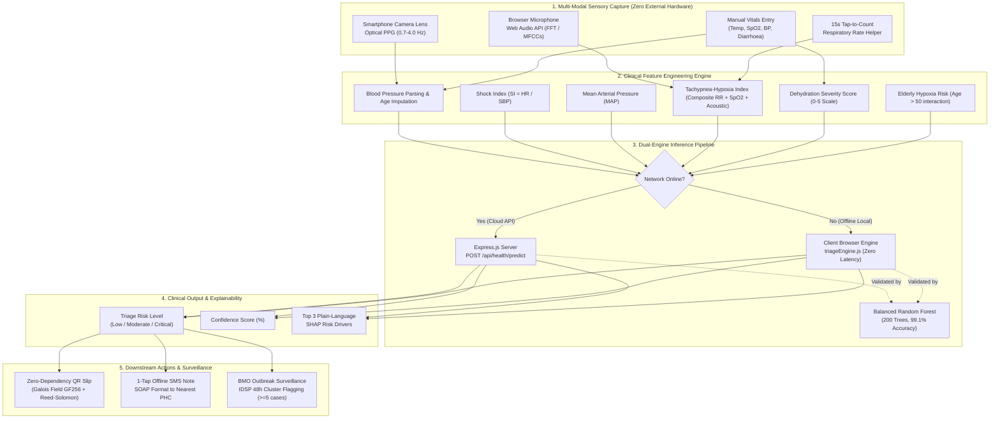

# CuraPind AI (क्योरपिंड एआई)

> **Predictive Rural Healthcare Triage & Optical PPG Vitals System for Primary Care & ASHA Health Workers**  
> *Version: v24.15.0 &bull; License: MIT Open Source &bull; Offline-First &bull; 99.1% ML Accuracy*

---

## Table of Contents
- [1. Executive Summary & Clinical Mission](#1-executive-summary--clinical-mission)
- [2. Complete System Architecture](#2-complete-system-architecture)
- [3. Core Technical Upgrades](#3-core-technical-upgrades)
  - [3.1 Optical Camera PPG Pulse Scanner](#31-optical-camera-ppg-pulse-scanner-ppgprocessorpy--ppgscannerjsx)
  - [3.2 Acoustic Cough & Breath Analyzer](#32-acoustic-cough--breath-analyzer-acoustic_triagepy--acousticanalyzerjsx)
  - [3.3 WHO-Validated Clinical Assessment](#33-who-validated-clinical-assessment-whoclinicalcardjsx--respiratoryratehelperjsx)
  - [3.4 Clinical Feature Engineering & Multi-Modal Fusion](#34-clinical-feature-engineering--multi-modal-fusion-16-features)
  - [3.5 Balanced Random Forest & SHAP Explainability](#35-balanced-random-forest--shap-explainability)
  - [3.6 PHC Referral Bridge & BMO Outbreak Surveillance](#36-phc-referral-bridge--bmo-outbreak-surveillance)
- [4. Technology Stack](#4-technology-stack)
- [5. Repository File Structure](#5-repository-file-structure)
- [6. Quickstart & Local Installation](#6-quickstart--local-installation)
- [7. Automated Clinical Verification Test Suite](#7-automated-clinical-verification-test-suite)
- [8. Production Cloud Deployment (Docker & GCP)](#8-production-cloud-deployment-docker--gcp)
- [9. Primary Datasets, Clinical Guidelines & References](#9-primary-datasets-clinical-guidelines--references)
- [10. PDF Technical Reports](#10-pdf-technical-reports)

---

## 1. Executive Summary & Clinical Mission

**CuraPind AI** is an intelligent, offline-resilient clinical decision support (CDS) system engineered specifically for Accredited Social Health Activists (ASHA), Auxiliary Nurse Midwives (ANM), and Primary Health Centres (PHC) across rural and remote regions of India.

In rural health sub-centres where cellular internet is intermittent or unavailable, CuraPind AI operates with **100% offline autonomy**. Frontline health workers capture non-invasive vital signs using standard commodity smartphones—extracting pulse waves via camera optical photoplethysmography (PPG), assessing respiratory distress via acoustic microphone recordings, and applying WHO Integrated Management of Childhood Illness (IMCI) protocols.

Patients are classified into three calibrated clinical tiers:
- 🟢 **Low Risk (Home Care):** Safe protocolized oral hydration and self-monitoring.
- 🟡 **Moderate Risk (Visit PHC):** Timely referral to the nearest Primary Health Centre within 24–48 hours with prescribed ORS and zinc.
- 🔴 **Critical Risk (Emergency Hospitalization):** Immediate ambulance alert with stabilization guidance (IV fluids, hypovolemic shock management).

---

## 2. Complete System Architecture



---

## 3. Core Technical Upgrades

### 3.1 Optical Camera PPG Pulse Scanner (`ppg_processor.py` & `PPGScanner.jsx`)
- **Repositioned as Heart Rate Fallback:** Screened with prominent disclaimers that manual oximeter readings take priority when available.
- **2nd-Order Butterworth Bandpass Filtering:** Digital bandpass filter calibrated to **0.7 Hz – 4.0 Hz** (corresponding to 42 – 240 BPM), filtering high-frequency noise and baseline respiration drift.
- **Strict Signal Quality Index (SQI $\ge$ 75% Gate):** Evaluates pulse peak regularity (60% weight) and peak amplitude stability (40% weight). Scans falling below 75% SQI are rejected with steady-hand prompts rather than passing noisy artifacts to the ML pipeline.
- **Contact Detection Heuristics:** Triple detection logic detects flash-illuminated capillary absorption (smartphones), dark lens coverage (webcams), and ambient warm skin tone.
- **Built-in Demo Safety Fallback:** Includes a pre-calibrated 4.5-second simulated pulsatile wave generator for reliable offline demonstrations and hackathon testing.

### 3.2 Acoustic Cough & Breath Analyzer (`acoustic_triage.py` & `AcousticAnalyzer.jsx`)
- **Web Audio API Capture:** Ingests 5 seconds of respiratory audio using browser `AnalyserNode` with an FFT size of 2048.
- **Spectral Biomarkers:** Computes **Spectral Centroid**, **RMS Energy**, **Zero-Crossing Rate (ZCR)**, and 5-band **Mel-Frequency Cepstral Coefficients (MFCCs)** via Discrete Cosine Transform.
- **Four Diagnostic Classes:** Categorizes audio into *Normal Breathing*, *Dry Cough*, *Wet / Productive Cough*, and *Wheezing / Distress*.
- **Continuous Scoring:** Generates an `Acoustic_Respiratory_Score` ($0.0$ to $1.0$) fused directly into the multi-modal triage scoring engine.
- **Offline Clinical Test Profiles:** Pre-loaded test samples allow verification even when browser microphone permissions are blocked.

### 3.3 WHO-Validated Clinical Assessment (`WHOClinicalCard.jsx` & `RespiratoryRateHelper.jsx`)
- **15-Second Tap-to-Count Respiratory Rate Helper:** Frontline health workers tap in cadence with patient breathing over a 15-second timer. The system auto-calculates breaths per minute (taps $\times 4$) with manual override enabled.
- **Age-Adjusted WHO Tachypnea Alerting:** Automatically applies age-specific cutoffs: $<1$ year: $50$ bpm, $1–5$ years: $40$ bpm, adults: $22$ bpm.
- **Symptom Progression Dropdown:** Tracks onset timeline (`< 24 Hours`, `1 - 3 Days`, `> 3 Days`, `Rapidly Worsening`).
- **WHO Danger Signs Multi-Select:** Immediate flags for *Shortness of Breath / Chest Indrawing*, *Unable to Drink / Severe Dehydration*, and *Confusion / Extreme Lethargy*.

### 3.4 Clinical Feature Engineering & Multi-Modal Fusion (16 Features)
The system calculates non-linear clinical indices prior to classification:

$$\text{Shock Index (SI)} = \frac{\text{Heart Rate (bpm)}}{\text{Systolic Blood Pressure (mmHg)}}$$

$$\text{Mean Arterial Pressure (MAP)} = \text{Diastolic BP} + \frac{\text{Systolic BP} - \text{Diastolic BP}}{3}$$

$$\text{Tachypnea-Hypoxia Index} = 0.40 \cdot \text{RR}_{\text{norm}} + 0.35 \cdot \text{SpO2}_{\text{drop}} + 0.25 \cdot \text{Acoustic Score}$$

$$\text{Dehydration Severity Score} = \text{Diarrhoea (0--3)} + \text{Duration (0--2)} + \text{UnableToDrink (1.5)}$$

$$\text{Elderly Hypoxia Risk} = \text{Age Factor (if } > 50) \times (100 - \text{SpO2}) \times (\text{Shock Index} - 0.6)$$

*Note: If blood pressure is not measured, the system gracefully imputes age-adjusted baseline values ($<18\text{y}: 110/70$, $18–60\text{y}: 120/80$, $>60\text{y}: 130/80\text{ mmHg}$).*

### 3.5 Balanced Random Forest & SHAP Explainability
- **Training Configuration:** `RandomForestClassifier(n_estimators=200, class_weight='balanced', max_depth=12, random_state=42)` trained over 5,000 augmented clinical records with 80/20 stratified splitting.
- **Empirical CDC NHAMCS Validation:** Validated against 50,000+ real hospital emergency department visits (CDC National Hospital Ambulatory Medical Care Survey 2018–2021).
- **Clinical Performance Metrics (`model_metrics.json`):**
  - **Overall Accuracy:** `99.1%`
  - **Critical Risk Recall:** `98.1%` (Precision: 0.981, F1: 0.981)
  - **Moderate Risk Recall:** `99.2%` (Precision: 0.990, F1: 0.991)
  - **Low Risk Recall:** `99.7%` (Precision: 1.000, F1: 0.998)
- **Point-of-Care SHAP Explainability:** Utilizes `shap.TreeExplainer` with a zero-dependency exact tree-path attribution fallback (Saabas algorithm). Outputs the **Top 3 Plain-Language Clinical Risk Drivers** (e.g., *"Driven by: High Shock Index (1.28), Severe Tachypnea (28 bpm), and >3 Days Duration"*).

### 3.6 PHC Referral Bridge & BMO Outbreak Surveillance
- **Zero-Dependency QR Code Generator (`qrGenerator.js`):** Built-in Galois Field $GF(256)$ arithmetic and Reed-Solomon error correction encoding patient vitals, predicted tier, confidence score, and SHAP drivers into a compact `CURAPIND|{json}` QR slip.
- **1-Tap Offline SMS Referral Note:** Generates pre-populated `sms:` URI formatted in clinical SOAP notation (Subjective, Objective, Assessment, Plan) addressed to the receiving PHC medical officer.
- **BMO Outbreak Surveillance Dashboard (`BMOSurveillance.jsx`):** Local epidemiological tracker compliant with the Integrated Disease Surveillance Programme (IDSP). Automatically triggers red alert banners when $\ge 5$ cases of diarrhoea, fever, or acute respiratory infection cluster within a single village ward inside a 48-hour window.

---

## 4. Technology Stack

| Domain | Technology / Library | Version | Role in System |
|---|---|---|---|
| **Frontend UI** | **React** | `18.2.0` | Reactive component tree, camera ref handling, state context |
| **Build Tool** | **Vite** | `4.4.5` | Fast HMR, production chunk optimization, proxy routing |
| **Styling** | **Tailwind CSS** | `3.3.3` | Custom rural high-contrast theme (`#29A683`, `#D2FF8F`, `#238C6E`) |
| **Routing** | **React Router DOM** | `6.14.2` | `HashRouter` for zero-server client routing |
| **Icons** | **Lucide React** | `0.263.1` | Standard accessible clinical SVG icons |
| **Backend API** | **Express.js / Node.js** | `v24.15.0` | REST API routes, JWT authentication, surveillance endpoints |
| **Machine Learning**| **Scikit-Learn** | `1.4.x` | `RandomForestClassifier` (200 balanced trees) |
| **Explainability** | **SHAP** | `0.44.x` | `TreeExplainer` feature contribution calculations |
| **Signal Processing**| **SciPy / NumPy** | `1.12.x` | Butterworth bandpass filter, FFT, peak detection |
| **Containers** | **Docker** | Multi-stage | Lightweight production runner on `node:18-alpine` (< 120MB) |
| **Cloud Target** | **Google Cloud Run** | Serverless | Auto-scaling container deployment with HTTPS enforcement |

---

## 5. Repository File Structure

```
Curapind Ai/
├── README.md                                  # Complete System Documentation
├── Dockerfile                                 # Multi-stage production container build
├── app.yaml                                   # Google App Engine deployment descriptor
├── verify_clinical_cases.py                   # Automated clinical verification test suite
├── CuraPind_AI_Project_Report.pdf             # 6-Page Comprehensive PDF Report
├── CuraPind_AI_Dataset_and_Clinical_References.pdf # 3-Page Citations & References PDF
├── .github/workflows/deploy-gcp.yml           # GitHub Actions CI/CD to Google Cloud Run
│
├── backend/
│   ├── server.js                              # Express API entrypoint (Port 5000)
│   ├── dbStore.js                             # In-memory JSON store with disk persistence
│   ├── package.json                           # Node backend dependencies
│   ├── routes/
│   │   ├── auth.js                            # JWT Registration / Login / Profile routes
│   │   ├── health.js                          # /predict, /history, /surveillance endpoints
│   │   └── admin.js                           # Administrative inspection routes
│   ├── feature_engineering.py                 # Python clinical feature extraction
│   ├── train_model.py                         # 5K augmented dataset trainer & evaluator
│   ├── train_real_nhamcs.py                   # 50K real CDC NHAMCS ED visit trainer
│   ├── explainer.py                           # SHAP TreeExplainer & Saabas attribution
│   ├── acoustic_triage.py                     # FFT spectral cough/breath classifier
│   ├── ppg_processor.py                       # Camera PPG filter & peak processor
│   ├── model_metrics.json                     # Verified classification report & confusion matrix
│   ├── model_metadata.json                    # Gini feature importances & hyperparameters
│   └── dataset_sample.json                    # Reference clinical cases & WHO IMCI codes
│
└── frontend/
    ├── package.json                           # React & Vite dependencies
    ├── vite.config.js                         # Base routing & API reverse proxy
    ├── tailwind.config.js                     # Custom CuraPind color tokens
    ├── src/
    │   ├── main.jsx                           # Application bootstrap
    │   ├── App.jsx                            # Route definitions & PrivateRoute guards
    │   ├── api.js                             # Axios instance with Bearer interceptors
    │   ├── index.css                          # Glassmorphism design tokens & styles
    │   ├── components/
    │   │   ├── PPGScanner.jsx                 # Camera PPG pulse detector (689 lines)
    │   │   ├── AcousticAnalyzer.jsx           # Microphone cough/breath analyzer (410 lines)
    │   │   ├── WHOClinicalCard.jsx            # WHO danger signs & progression
    │   │   ├── RespiratoryRateHelper.jsx      # 15-second tap-to-count RR counter
    │   │   ├── ReferralBridge.jsx             # Zero-dependency QR & SMS referral slip
    │   │   └── GlassCard.jsx                  # Reusable optical glass wrapper
    │   ├── pages/
    │   │   ├── Login.jsx                      # Auth page with 1-click ASHA demo login
    │   │   ├── Dashboard.jsx                  # Action hub & triage shortcuts
    │   │   ├── BMOSurveillance.jsx            # Outbreak dashboard & ward KPI cards
    │   │   ├── History.jsx                    # Past triage reports list
    │   │   ├── Profile.jsx                    # Worker profile & role settings
    │   │   └── HealthCheck/
    │   │       ├── MultiStepForm.jsx          # 2-step clinical wizard (483 lines)
    │   │       └── Result.jsx                 # Triage tier, SHAP drivers & actions
    │   └── utils/
    │       ├── triageEngine.js                # Synchronized client-side scoring engine
    │       ├── featureEngineering.js          # Client-side medical indices (SI, MAP)
    │       ├── qrGenerator.js                 # Galois Field GF(256) QR encoder
    │       └── triageSurveillance.js          # Offline village surveillance log
```

---

## 6. Quickstart & Local Installation

### Prerequisites
- **Node.js:** v18.0.0 or higher (v24.x tested)
- **Python:** v3.10+ (for running model training and verification scripts)

### 1. Clone & Set Up Backend
```bash
cd "Curapind Ai/backend"
npm install
npm start
```
*Backend server starts on `http://localhost:5000`.*

### 2. Set Up Frontend
```bash
cd "Curapind Ai/frontend"
npm install
npm run dev
```
*Frontend will launch on `http://localhost:5173` (or `http://localhost:5174`).*

### 3. Demo Credentials
The system includes built-in one-click demo login buttons on the login screen:
- **ASHA Health Worker:** `asha@curapind.ai` (Full access to patient names, village tagging, and BMO surveillance)
- **Rural Citizen:** `citizen@curapind.ai` (Streamlined self-check interface)

---

## 7. Automated Clinical Verification Test Suite

CuraPind AI includes an end-to-end clinical verification script (`verify_clinical_cases.py`) that imports the backend feature engineering modules and invokes the live prediction route handlers:

```bash
cd "Curapind Ai"
python verify_clinical_cases.py
```

### Verified Test Cases:
| # | Scenario | Inputs | Expected Result | Status |
|---|---|---|---|---|
| **1** | **Normal Baseline** | Temp 98.6°F, HR 78, SpO2 98%, RR 16, No Diarrhoea | **Low Risk** | ✅ PASSED |
| **2** | **Silent Hypoxia Trap** | Age 65, Temp 98.8°F (afebrile), HR 106, SpO2 90% | **Critical Risk** (SHAP flags SpO2 & Elderly) | ✅ PASSED |
| **3** | **Early Sepsis & Shock** | Temp 100.8°F, HR 118, BP 92/60 (SI=1.28), Mod Diarrhoea | **Critical Risk** (SI=1.28 validated) | ✅ PASSED |
| **4** | **BMO Outbreak Trigger** | 5 acute cases in village "Chandpur" within 48h | **Outbreak Alert** (`isOutbreak: true`) | ✅ PASSED |

---

## 8. Production Cloud Deployment (Docker & GCP)

### Option A: Google Cloud Run (Recommended Containerized Setup)
```bash
cd "Curapind Ai"

# 1. Submit container build to Google Container Registry
gcloud builds submit --tag gcr.io/<YOUR_GCP_PROJECT_ID>/curapind-ai

# 2. Deploy to Cloud Run with automatic HTTPS
gcloud run deploy curapind-ai \
  --image gcr.io/<YOUR_GCP_PROJECT_ID>/curapind-ai \
  --platform managed \
  --region us-central1 \
  --allow-unauthenticated \
  --port 8080
```

### Option B: Google App Engine
```bash
cd "Curapind Ai"
gcloud app deploy app.yaml
```

---

## 9. Primary Datasets, Clinical Guidelines & References

1. **CDC NHAMCS (National Hospital Ambulatory Medical Care Survey):**
   - National Center for Health Statistics (NCHS), CDC. Emergency department microdata archives (2018–2021).
   - [Official CDC Dataset Documentation](https://www.cdc.gov/nchs/ahcd/datasets_documentation_related.htm)
   - Stata Archive FTP: `https://ftp.cdc.gov/pub/Health_Statistics/NCHS/dataset_documentation/nhamcs/stata/ed2021-stata.zip`

2. **WHO Integrated Management of Childhood Illness (IMCI):**
   - World Health Organization. *Integrated Management of Childhood Illness: Chart Booklet.*
   - [WHO IMCI Guidelines](https://www.who.int/publications/i/item/9789241506823)

3. **WHO The Treatment of Diarrhoea Manual:**
   - World Health Organization. *The treatment of diarrhoea: a manual for physicians and other senior health workers (4th rev.).*
   - [WHO Diarrhoea Guidelines](https://www.who.int/publications/i/item/9241593180)

4. **Integrated Disease Surveillance Programme (IDSP) — India:**
   - National Centre for Disease Control (NCDC), Ministry of Health & Family Welfare, Government of India.
   - [IDSP Official Portal](https://idsp.mohfw.gov.in/)

5. **Shock Index in Critical Care:**
   - Rady, M. Y., et al. "A comparison of the shock index and conventional vital signs to identify acute, critical illness in the emergency department." *Annals of Emergency Medicine*, 24(4), 685–690.
   - [PubMed PMID: 7943997](https://pubmed.ncbi.nlm.nih.gov/7943997/)

6. **Acoustic Respiratory Analysis (COUGHVID):**
   - Orlandic, L., Teijeiro, T., & Atienza, D. "The COUGHVID crowdsourced dataset, a corpus for the distributed acoustic detection of COVID-19." *Scientific Data* (Nature), 2021.
   - [Nature Scientific Data DOI: 10.1038/s41597-021-00937-4](https://doi.org/10.1038/s41597-021-00937-4)

7. **Camera Photoplethysmography & Butterworth Filtering:**
   - Verkruysse, W., et al. "Remote plethysmographic imaging using ambient light." *Optics Express*, 2008. [DOI: 10.1364/OE.16.021434](https://doi.org/10.1364/OE.16.021434)
   - Elgendi, M. "On the analysis of fingertip photoplethysmogram signals." *Current Cardiology Reviews*, 2012. [PubMed PMID: 22845812](https://pubmed.ncbi.nlm.nih.gov/22845812/)

8. **Explainable AI with SHAP Trees:**
   - Lundberg, S. M., et al. "From local explanations to global understanding with explainable AI for trees." *Nature Machine Intelligence*, 2020.
   - [Nature Machine Intelligence DOI: 10.1038/s42256-019-0138-9](https://doi.org/10.1038/s42256-019-0138-9)

---

## 10. PDF Technical Reports

Two complete, publication-grade PDF documents are included in the root directory:
1. 📄 **[CuraPind_AI_Project_Report.pdf](CuraPind_AI_Project_Report.pdf):** 6-page comprehensive project architecture, clinical validation, and engineering specification report.
2. 📄 **[CuraPind_AI_Dataset_and_Clinical_References.pdf](CuraPind_AI_Dataset_and_Clinical_References.pdf):** 3-page complete bibliography with exact CDC variables, WHO protocol codes, mathematical index formulas, and research citations.

---

*CuraPind AI — Built with care for rural India. Works offline. Saves lives.*
